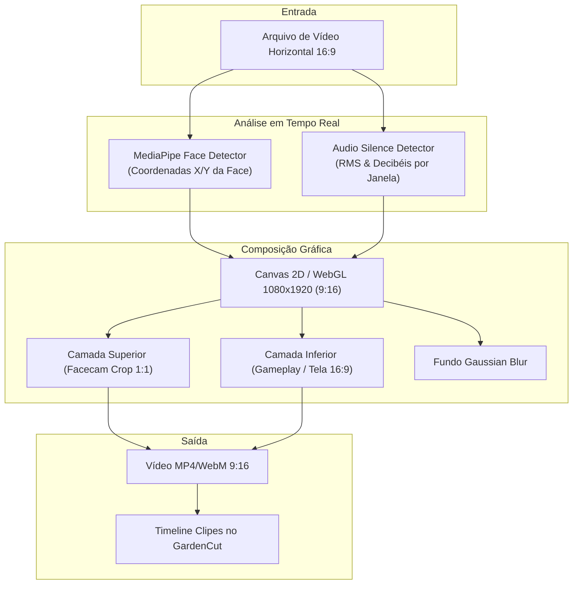

# 🌿 Garden Auto-Framer

> **Reenquadrador Inteligente de Vídeos para Shorts, Reels & TikTok (16:9 ➔ 9:16)** com detecção facial via Visão Computacional local, layout duplo (Split Facecam + Gameplay), desfoque dinâmico e corte de silêncio.

---

## 🎯 Por que o Garden Auto-Framer?

A maior dor de criadores que gravam podcasts, aulas, entrevistas e gameplays em computadores é que o material é gravado na horizontal (**16:9**), enquanto 85% do engajamento atual do TikTok, Instagram Reels e YouTube Shorts acontece na vertical (**9:16**).

Editar isso manualmente em Premiere ou DaVinci exige duplicar trilhas, aplicar máscaras na mão, reenquadrar o rosto quando a pessoa se mexe e renderizar clipes um a um.

O **Garden Auto-Framer automatiza esse fluxo 100% no navegador**:
* **Detecção Facial Contínua (MediaPipe Face Detection):** Localiza a face do criador e centraliza suavemente no terço superior (*Face Tracking com interpolação suave sem solavancos*).
* **Composição Multi-Layout em 1 Clique:**
  * **Split-Screen Streamer:** Rosto no topo (35% da tela) + Gameplay/Tela no centro/inferior (65%).
  * **Smart Gaussian Blur Background:** Vídeo horizontal centralizado com fundo espelhado e desfocado para preencher as bordas verticais.
  * **Auto-Pan Tracking:** Câmera que acompanha o objeto ou pessoa em movimento pela tela horizontal.
* **Corte Inteligente de Silêncio (*Silence Stripper*):** Remove automaticamente pausas e respirações longas para elevar o ritmo do vídeo e a retenção do público.
* **Sincronização com o GardenCut:** Exporta o projeto recortado diretamente como clipe na timeline do **GardenCut** para retoques finais de cor, música e legendas.

---

## 🏛️ Arquitetura do Software

---

## 🛠️ Stack Tecnológica

* **Linguagem:** TypeScript 5.8+
* **Framework:** React 19 + Vite 8
* **Visão Computacional:** Google MediaPipe Face Detection (WebGL/Wasm)
* **Composição Gráfica:** HTML5 Canvas 2D + WebGL Shaders
* **DSP de Áudio:** Web Audio API (`AnalyserNode`)

---

## 🌿 Ecossistema GC Studio

Este projeto integra o ecossistema de aplicações criativas mantidas pelo estúdio **GC Studio** (Felipe Gardenghi).  
Para conhecer outras ferramentas da suíte:
* 🎬 **[GardenCut](https://github.com/FelipeGardenghiDev/garden-cut):** Editor de vídeo não-linear web.
* 📝 **[Garden Subtitle](https://github.com/FelipeGardenghiDev/garden-subtitle):** Gerador de legendas cinéticas.
* 🎨 **[Garden Pixel Editor](https://github.com/FelipeGardenghiDev/garden-pixel-editor):** Editor de pixel art e isometria 2:1.
* 🏛️ **[GC Studio Hub](https://github.com/FelipeGardenghiDev/projeto-homestudio):** Central oficial do estúdio.

---

## 📄 Licença
Distribuído sob a licença MIT. Criado por Felipe Gardenghi.
